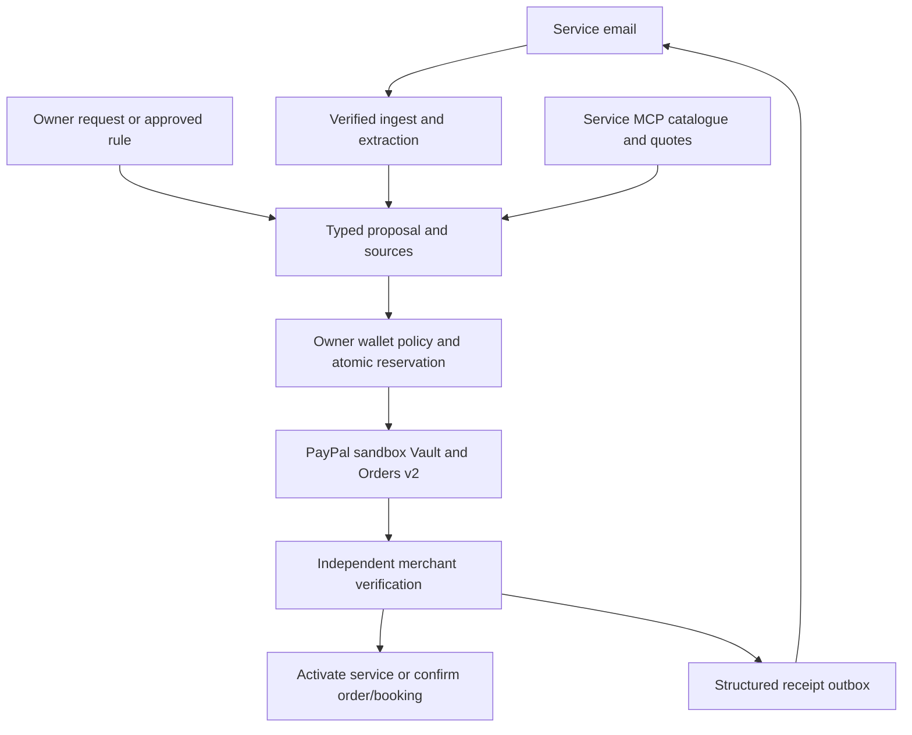

# Mailbox

An address for the messages. A wallet for the decisions.

Mailbox is a consumer service dashboard with an ask bar, source-backed proposals and configurable PayPal spending permission. Its reference demo follows Maya through one month of a fictional streaming service with cancellation arranged, then coffee, a restaurant deposit and a conditional pet-food purchase.

The mock services use a real MCP server and the reusable [service SDK](packages/service-sdk/README.md). All services, products, the film and background emails are invented fixtures. Real-world merchant adoption and universal service coverage are not claimed.

## Local setup

Requires Node 24 or later and npm. From this workspace:

```sh
npm ci
npm run setup:local
npm run dev
```

Open the printed local URL. Read `DEMO_ACCESS_KEY` from the private `.env` to sign in. The setup command generates app/session/MCP secrets and preserves existing credentials. Do not commit `.env` or rotate the application key against an existing encrypted wallet database.

For the production server, including its background worker:

```sh
npm run build
npm start
```

The same server hosts the dashboard, MCP endpoints, PayPal webhook and protected merchant callbacks. Configure the public `APP_URL` before a hosted consent flow. The default local origin is `http://127.0.0.1:3000`; `MOCK_MERCHANT_URL` points to the same server. Run one persistent instance for this SQLite-backed demonstration.

## Credentials and actual acceptance

Fill `.env` using `.env.example`:

| Variable | Purpose |
| --- | --- |
| `PAYPAL_CLIENT_ID`, `PAYPAL_CLIENT_SECRET` | Sandbox business app with Vault enabled |
| `PAYPAL_MERCHANT_ID` | Matching sandbox business merchant account |
| `PAYPAL_WEBHOOK_ID` | Registered capture webhook ID after hosting |
| `AGENTMAIL_API_KEY` | Dedicated receiving inboxes and controlled merchant sending |
| `AGENTMAIL_WEBHOOK_SECRET` | Signed inbound webhook verification |
| `OPENAI_API_KEY`, optional `OPENAI_MODEL` | Structured request interpretation and email extraction |
| `RENDER_API_KEY`, `RENDER_OWNER_ID` | Hosting setup, if using Render |

Four service addresses plus merchant sending need sufficient inbox capacity. Do not assume the three-inbox free plan covers the full demonstration. Model-backed requests, provider delivery, real Vault charging and hosted execution must be verified with the actual configured accounts. Offline tests use explicit provider fixtures and do not establish sandbox acceptance.

Without service credentials, the app supports clearly labeled fixture walkthroughs and preview emails. It does not invent completed payments, received mail or model calls. The default model is `gpt-5-mini`; choose an accessible structured-output model through `OPENAI_MODEL` if needed.

## Demonstration data and reset

Open **Demo setup** in the app. **Load preview emails** loads the 24 committed message fixtures with preview labels. **Send live fixture emails** provisions the owned service inboxes and sends those same fixtures through AgentMail. Merchant confirmations are live outbox messages following verified capture. Both the service view and generic before-inbox use the same stored data.

**Reset workspace** disables the old workspace's queued authority and cancels controlled streaming access, then starts a fresh private workspace. It retains historical sandbox payments and cannot silently discard an uncertain in-flight payment. Seeding and replay are idempotent within their recorded request identities.

## Architecture



The raw-email extractor has no tools. Model output cannot grant permissions, choose a payee, change budgets or assert owner approval. Final prices come from merchant quotes, with fees included. Wallets enforce period and per-action caps, daily limits, expiry, pause, revocation, quote validity and owner scope. Stable payment identities and unresolved reservations protect retries.

Coffee comparison checks equivalent pack variants by unit price, rejects stale email evidence, verifies stock/current quotes and applies wallet limits. Its scope is displayed; it is not represented as a global retail search. HTML extraction retains hidden preheaders. Image-only content and attachments are marked unread; OCR/vision/PDF handling remains follow-on work.

Email supplies context. A supported service connector supplies actions. MCP standardizes only the tools a service actually exposes and authorizes. Channel3 is a proposed optional discovery source, not an implemented universal checkout path.

## MCP interface

Authenticate with `Authorization: Bearer <MOCK_MERCHANT_TOKEN>`. The root `/mcp` exposes catalogue search and plan lookup. `/mcp/<service-id>` exposes that service's supported tools:

| Service ID | Type | Action tools |
| --- | --- | --- |
| `harbor-play` | One-month streaming | `subscribe`, `cancel` |
| `lantern-cinema` | Film rental | `place_order` |
| `coast-screen` | One-month streaming | `subscribe`, `cancel` |
| `basil-market` | Coffee products | `place_order` |
| `marina-table` | Table deposit | `book` |
| `daily-paws` | Pet supplies | `place_order` |

Service endpoints also expose `search_catalogue`, `get_plans`, `get_quote` and `get_status`. The agent never receives the admin token or payment credentials. The experimental merchant host uses one configured fixture customer; the consumer app separately scopes private workspaces and wallet records.

An independently runnable Node host is available with `npm run start:merchant` after `npm run build:core`; it uses `MOCK_MERCHANT_PORT` (3011 by default). The integrated app is the normal entry point.

## Checks

```sh
npm test
npm run test:browser
npm run format:check
```

Core checks exercise actual MCP HTTP clients plus injected PayPal responses, financial limits and races, lost-response recovery, ownership, encryption, callback verification, month-end cancellation and email parsing. Browser checks use isolated databases and empty external credentials, covering proposals, credential gates, messages, comparison, saved rules, reset and phone layout. Browser builds use `.next-qa` to preserve an already-running local app's production files.

A live acceptance run must additionally prove saved-token charging, the real merchant callback and received email, model-backed requests, cancellation/condition behavior and the post-approval timing target. Submission claims must follow that evidence.

## Hosting and submission

The [deployment handoff](DEPLOYMENT.md) and [Render Blueprint](render.yaml) describe the persistent hosted configuration and the live acceptance run. The Blueprint has not been deployed.

The [submission draft and recording plan](SUBMISSION.md) keep the presentation tied to verified behavior.

Use persistent storage for `data/app.sqlite` and `data/merchant.sqlite`, keep private app/merchant secrets stable and serve HTTPS. PayPal callback: `/webhooks/paypal`; AgentMail callback: `/api/webhooks/agentmail`. Keep hosting available through the judging window.

Public repository URL, hosted demo URL, real sandbox acceptance evidence and final YouTube video are pending. No Devpost submission has been made. Agent names and natural-language dashboard customization are outside the critical build; the latter is explicitly a nice-to-have.

MIT licensed. The service SDK is an internal workspace package, not an adopted or published merchant network.
